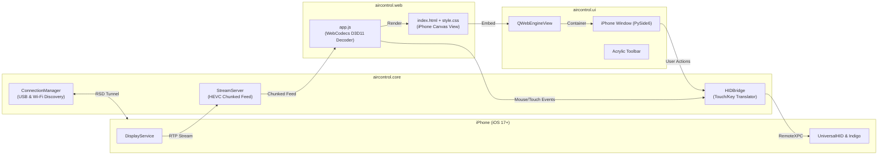

# Aircontrol Implementation Plan

> **For agentic workers:** REQUIRED SUB-SKILL: Use superpowers:subagent-driven-development to implement this plan task-by-task. Steps use checkbox (`- [ ]`) syntax for tracking.

**Goal:** Xây dựng phần mềm Windows nguyên bản (Aircontrol) stream màn hình iPhone với độ trễ thấp (<30ms, 60 FPS) qua WebCodecs Direct3D 11 GPU và điều khiển tương tác (chuột, vuốt, lăn cuộn, bàn phím, phím cứng vật lý) trên giao diện desktop mô phỏng chiếc iPhone 16 Pro cao cấp.

**Architecture:** Tách biệt 3 tầng: Tầng Lõi (`aircontrol.core`) quản lý kết nối iPhone (USB usbmuxd & Wi-Fi Bonjour qua `UserspaceRsdTunnel`), khởi tạo Stream Server HEVC thời gian thực và cầu nối HID; Tầng Web (`aircontrol.web`) đảm nhiệm giải mã phần cứng WebCodecs không lo deadlock FFmpeg và hiển thị canvas; Tầng Desktop (`aircontrol.ui`) cung cấp cửa sổ PySide6 Bespoke Native chuẩn form máy iPhone với Dynamic Island, nút vật lý hai bên thân máy và thanh công cụ Acrylic.

**Architecture Diagram:**



**Tech Stack:** Python 3.11+, PySide6 (Qt for Python), QtWebEngineWidgets (Direct3D 11 GPU WebCodecs), pymobiledevice3 (CoreDevice, RemoteXPC, UniversalHIDService, UserspaceRsdTunnel), pytest.

**Spec:** [`docs/superpowers/specs/2026-09-22-aircontrol-design.md`](file:///d:/Coding/Aircontrol/docs/superpowers/specs/2026-09-22-aircontrol-design.md)

## Global Constraints

- **Python Version**: >= 3.11
- **Disk Path Discipline**: Tuyệt đối không ghi file rác lên ổ C:. Mọi mã nguồn, config, asset chỉ nằm tại `d:\Coding\Aircontrol`.
- **Typographic Standards**: Font Google Fonts hỗ trợ tiếng Việt đầy đủ (`Be Vietnam Pro` hoặc `Inter` với `&subset=vietnamese`).
- **Zero FFmpeg Deadlock**: Toàn bộ việc giải mã video HEVC giao cho Chromium WebCodecs tăng tốc phần cứng Direct3D 11. Không dùng FFmpeg đa luồng trên CPU.
- **Bespoke Window Layout**: Cửa sổ Desktop chuẩn phong cách phần cứng iPhone (viền titanium, Dynamic Island, các nút vật lý tương tác trực tiếp trên viền máy).

---

## Proposed Changes

### Task 1: Thiết Lập Dự Án & Scaffolding

**Files:**
- Create: [`pyproject.toml`](file:///d:/Coding/Aircontrol/pyproject.toml)
- Create: [`aircontrol/__init__.py`](file:///d:/Coding/Aircontrol/aircontrol/__init__.py)
- Create: [`aircontrol/__main__.py`](file:///d:/Coding/Aircontrol/aircontrol/__main__.py)
- Create: [`run.bat`](file:///d:/Coding/Aircontrol/run.bat)
- Test: [`tests/test_scaffolding.py`](file:///d:/Coding/Aircontrol/tests/test_scaffolding.py)

**Interfaces:**
- Produces: Package `aircontrol` có thể import và chạy kiểm tra version cơ bản.

- [ ] **Step 1: Viết test scaffolding**
```python
def test_package_metadata():
    import aircontrol
    assert hasattr(aircontrol, "__version__")
    assert aircontrol.__version__ == "0.1.0"
```

- [ ] **Step 2: Chạy test để xác nhận FAIL**
Run: `python -m pytest tests/test_scaffolding.py -v`

- [ ] **Step 3: Triển khai pyproject.toml, package init và main**
Khởi tạo cấu trúc package `aircontrol`, `pyproject.toml` và `run.bat`.

- [ ] **Step 4: Chạy test để xác nhận PASS**
Run: `python -m pytest tests/test_scaffolding.py -v`

---

### Task 2: Module Quản Lý Kết Nối Thiết Bị (`aircontrol.core.connection`)

**Files:**
- Create: [`aircontrol/core/__init__.py`](file:///d:/Coding/Aircontrol/aircontrol/core/__init__.py)
- Create: [`aircontrol/core/connection.py`](file:///d:/Coding/Aircontrol/aircontrol/core/connection.py)
- Test: [`tests/test_connection.py`](file:///d:/Coding/Aircontrol/tests/test_connection.py)

**Interfaces:**
- Produces: `ConnectionManager` với các phương thức `list_devices()`, `connect(udid=None, via_wifi=False)`, `disconnect()`, `get_device_info()`.

- [ ] **Step 1: Viết test cho ConnectionManager**
```python
import pytest
from aircontrol.core.connection import ConnectionManager

@pytest.mark.asyncio
async def test_connection_manager_initial_state():
    mgr = ConnectionManager()
    assert not mgr.is_connected
    assert mgr.active_device is None
```

- [ ] **Step 2: Chạy test để xác nhận FAIL**
Run: `python -m pytest tests/test_connection.py -v`

- [ ] **Step 3: Triển khai `ConnectionManager`**
Tích hợp `pymobiledevice3` usbmuxd query, `UserspaceRsdTunnel`, tự động phát hiện thiết bị cắm cáp USB hoặc qua mạng Wi-Fi LAN.

- [ ] **Step 4: Chạy test để xác nhận PASS**
Run: `python -m pytest tests/test_connection.py -v`

---

### Task 3: Stream Server Phân Phối Luồng Cho WebCodecs (`aircontrol.core.stream_server`)

**Files:**
- Create: [`aircontrol/core/stream_server.py`](file:///d:/Coding/Aircontrol/aircontrol/core/stream_server.py)
- Test: [`tests/test_stream_server.py`](file:///d:/Coding/Aircontrol/tests/test_stream_server.py)

**Interfaces:**
- Produces: `StreamServer` với `start(host="127.0.0.1", port=0)`, `stop()`, endpoint stream HTTP chunked HEVC cho WebCodecs.

- [ ] **Step 1: Viết test cho StreamServer**
```python
import pytest
from aircontrol.core.stream_server import StreamServer

@pytest.mark.asyncio
async def test_stream_server_lifecycle():
    server = StreamServer(port=8899)
    assert not server.is_running
    await server.start()
    assert server.is_running
    await server.stop()
    assert not server.is_running
```

- [ ] **Step 2: Chạy test để xác nhận FAIL**
Run: `python -m pytest tests/test_stream_server.py -v`

- [ ] **Step 3: Triển khai StreamServer**
Khai thác bộ phân giải gói RTP HEVC RFC 7798 và phân phối HTTP chunked feed cho trình duyệt/WebEngine.

- [ ] **Step 4: Chạy test để xác nhận PASS**
Run: `python -m pytest tests/test_stream_server.py -v`

---

### Task 4: Cầu Nối Điều Khiển Cảm Ứng & Phím Cứng (`aircontrol.core.hid_bridge`)

**Files:**
- Create: [`aircontrol/core/hid_bridge.py`](file:///d:/Coding/Aircontrol/aircontrol/core/hid_bridge.py)
- Test: [`tests/test_hid_bridge.py`](file:///d:/Coding/Aircontrol/tests/test_hid_bridge.py)

**Interfaces:**
- Produces: `HIDBridge` với `send_touch(action, x, y)`, `send_scroll(delta_y, x, y)`, `send_button(button_name)`, `send_key(key_code)`.

- [ ] **Step 1: Viết test cho HIDBridge**
```python
from aircontrol.core.hid_bridge import HIDBridge, normalize_coordinates

def test_coordinate_normalization():
    # Chuẩn hóa [0..1] sang [0..65535]
    nx, ny = normalize_coordinates(0.5, 0.5)
    assert nx == 32767 or nx == 32768
    assert ny == 32767 or ny == 32768
```

- [ ] **Step 2: Chạy test để xác nhận FAIL**
Run: `python -m pytest tests/test_hid_bridge.py -v`

- [ ] **Step 3: Triển khai `HIDBridge`**
Mô phỏng cảm ứng điện dung 16-bit, chuyển đổi cuộn chuột thành cử chỉ vuốt, gọi `IndigoHIDService` cho phím Home, Power, Volume, Mute.

- [ ] **Step 4: Chạy test để xác nhận PASS**
Run: `python -m pytest tests/test_hid_bridge.py -v`

---

### Task 5: Giao Diện Web Khung Màn Hình iPhone & Bộ Giải Mã WebCodecs (`aircontrol/web`)

**Files:**
- Create: [`aircontrol/web/index.html`](file:///d:/Coding/Aircontrol/aircontrol/web/index.html)
- Create: [`aircontrol/web/style.css`](file:///d:/Coding/Aircontrol/aircontrol/web/style.css)
- Create: [`aircontrol/web/app.js`](file:///d:/Coding/Aircontrol/aircontrol/web/app.js)

**Interfaces:**
- Produces: Giao diện WebCodecs Canvas Direct3D 11, bắt sự kiện chuột (click, mousedown, mousemove, mouseup, wheel) và gửi về endpoint `/touch`.

- [ ] **Step 1: Xây dựng cấu trúc index.html với Dynamic Island và Canvas chuẩn tỷ lệ 19.5:9**
- [ ] **Step 2: Viết style.css giao diện mô phỏng iPhone 16 Pro, font Be Vietnam Pro**
- [ ] **Step 3: Viết app.js giải mã WebCodecs VideoDecoder và gửi tương tác chuột**

---

### Task 6: Cửa Sổ Desktop Native PySide6 Khung Máy iPhone (`aircontrol.ui`)

**Files:**
- Create: [`aircontrol/ui/__init__.py`](file:///d:/Coding/Aircontrol/aircontrol/ui/__init__.py)
- Create: [`aircontrol/ui/window.py`](file:///d:/Coding/Aircontrol/ui/window.py)
- Create: [`aircontrol/ui/webcodecs_view.py`](file:///d:/Coding/Aircontrol/ui/webcodecs_view.py)
- Create: [`aircontrol/ui/toolbar.py`](file:///d:/Coding/Aircontrol/ui/toolbar.py)
- Create: [`aircontrol/ui/app.py`](file:///d:/Coding/Aircontrol/ui/app.py)
- Test: [`tests/test_ui_window.py`](file:///d:/Coding/Aircontrol/tests/test_ui_window.py)

**Interfaces:**
- Produces: `AircontrolWindow` - cửa sổ Desktop Native mô phỏng chiếc iPhone với phím vật lý hai bên viền, thanh công cụ Acrylic và nhúng viewport WebEngine.

- [ ] **Step 1: Viết test cho giao diện cửa sổ Window**
```python
from PySide6.QtWidgets import QApplication
import pytest
from aircontrol.ui.window import iPhoneWindow

def test_window_creation(qapp):
    win = iPhoneWindow()
    assert win is not None
    assert win.windowTitle() == "Aircontrol - iPhone Mirror"
```

- [ ] **Step 2: Chạy test để xác nhận FAIL**
Run: `python -m pytest tests/test_ui_window.py -v`

- [ ] **Step 3: Triển khai các thành phần UI: Khung máy iPhone, Dynamic Island, Nút vật lý hai bên viền, WebEngine View và Toolbar Acrylic**
- [ ] **Step 4: Chạy test để xác nhận PASS**
Run: `python -m pytest tests/test_ui_window.py -v`

---

### Task 7: Tích Hợp Toàn Diện, Tối Ưu Hóa & Xác Minh Thực Tế

**Files:**
- Modify: [`aircontrol/__main__.py`](file:///d:/Coding/Aircontrol/aircontrol/__main__.py)
- Create: [`README.md`](file:///d:/Coding/Aircontrol/README.md)

- [ ] **Step 1: Liên kết vòng đời khởi động giữa Core Engine và Desktop UI**
- [ ] **Step 2: Chạy toàn bộ test suite tự động**
Run: `python -m pytest tests -v`
- [ ] **Step 3: Khởi chạy ứng dụng và xác nhận luồng stream, chuột và phím cứng trên thực tế**
Run: `.\run.bat`

---

## Verification Plan

### Automated Tests
```powershell
python -m pytest tests -v
```
Tất cả các bài test kiểm tra module kết nối, stream server, HID bridge và cửa sổ UI phải pass 100%.

### Manual Verification
1. Cắm iPhone bật chế độ Developer Mode qua cáp USB.
2. Chạy `.\run.bat`.
3. Kiểm tra:
   - Cửa sổ xuất hiện chuẩn hình dạng iPhone với viền titanium và Dynamic Island.
   - Màn hình iPhone hiển thị sắc nét, mượt mà 60 FPS qua giải mã phần cứng GPU.
   - Thao tác chuột: Click mở ứng dụng, vuốt trang màn hình chính, dùng con lăn chuột cuộn lướt web.
   - Bấm các phím vật lý trên viền máy (Power, Vol+, Vol-, Mute, Home Bar) phản hồi ngay lập tức trên iPhone.
