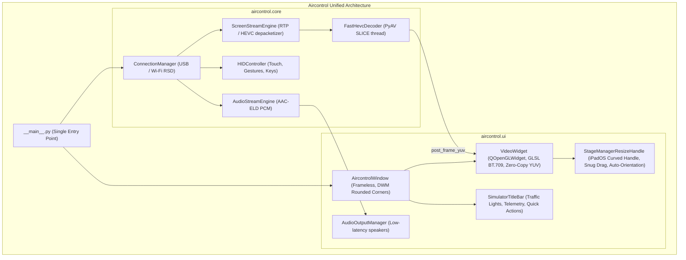

# Unified Architecture & Stage Manager Option A Implementation Plan

**Goal:** Establish a single, modern, unified PySide6 Qt + hardware OpenGL streaming architecture by eliminating all obsolete and competing duplicate files (QML, old web leftovers), and implement Stage Manager Option A (100% snug-fit scaling with zero black bars and intelligent auto-orientation transition).

**Architecture:** 
1. **Core**: Apple CoreDevice DisplayService RTP/HEVC streaming + PyAV C-level multi-threaded slice decoder (`FastHevcDecoder`) + non-blocking HID touch/gesture controller + userspace RSD tunnel with smart USB-first auto-fallback.
2. **UI & Presentation**: Unified `AircontrolWindow` housing `SimulatorTitleBar`, `VideoWidget` (zero-copy hardware OpenGL BT.709 shader streaming at 140 FPS with sub-pixel antialiasing), and `StageManagerResizeHandle` (proportional 100% snug-fit drag with zero black bars and auto-landscape threshold transition).

**Architecture Diagram:**

**Tech Stack:** Python 3.13, PySide6 6.8+ (Qt6), PyOpenGL, PyAV (libavcodec), pymobiledevice3, pytest.

---

## Global Constraints
- Zero disk pollution on `C:\`. All temporary tests run in-memory (`python -c`).
- Single unified architecture: No duplicate UI frameworks, no QML, no dead code.
- 100% test pass rate on all unit tests.
- Zero black borders (Zero Letterboxing) in Stage Manager mode: Window hugs the iPhone display snugly.

---

### Task 1: Clean Up Obsolete and Competing Files
**Files:**
- Delete: `aircontrol/ui/qml_app.py`
- Delete: `aircontrol/ui/qml_stream.py`
- Delete: `aircontrol/ui/qml/`
- Delete: `tests/test_qml_stream.py`
- Delete: `aircontrol/ui/app.py`
- Delete: `aircontrol/ui/toolbar.py`
- Modify: `tests/test_ui_window.py`

- [ ] **Step 1: Update `tests/test_ui_window.py` to remove `AcrylicToolbar` reference and test `SimulatorTitleBar`**
- [ ] **Step 2: Delete all obsolete QML and legacy toolbar files**
- [ ] **Step 3: Run `pytest` to verify 100% test pass without dead code**

---

### Task 2: Implement Stage Manager Option A (Zero Black Bars & Auto-Landscape)
**Files:**
- Modify: `aircontrol/ui/stage_manager_handle.py`
- Modify: `aircontrol/ui/window.py`
- Modify: `aircontrol/ui/video_widget.py`
- Modify: `tests/test_ui_window.py`

- [ ] **Step 1: Update `StageManagerResizeHandle` in `stage_manager_handle.py`**:
  - Dragging scales window proportionally to exact iPhone aspect ratio (`win._calc_window_width(target_h)`), completely eliminating black bars.
  - Detect horizontal threshold: If user drags horizontally outward by > 75px while in Portrait, trigger smooth auto-rotation to Landscape (`win.set_orientation(270)`).
  - Detect vertical threshold: If user drags vertically downward by > 75px while in Landscape, trigger smooth auto-rotation to Portrait (`win.set_orientation(0)`).
  - Double-click snaps window to standard compact height (710px portrait / 420px landscape).
- [ ] **Step 2: Update `AircontrolWindow` in `window.py`**:
  - Ensure window resize methods always snugly hug the iPhone display aspect ratio.
- [ ] **Step 3: Update `VideoWidget` in `video_widget.py`**:
  - Borderless Stage Manager mode sets viewport to 100% of the snug window with zero black bars.
- [ ] **Step 4: Update `tests/test_ui_window.py`** to test snug-fit resize and auto-landscape threshold transition.
- [ ] **Step 5: Run `pytest` to verify 100% tests passing**.
