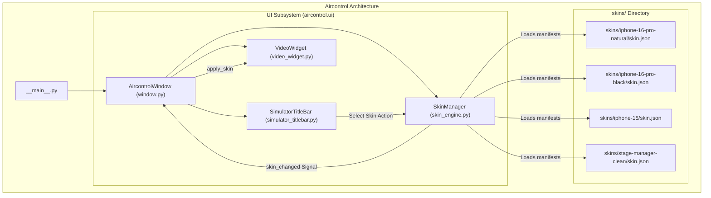

# Extensible Device Skinning Engine & Streamlined UI Implementation Plan

> **For agentic workers:** REQUIRED SUB-SKILL: Use superpowers:subagent-driven-development to implement this plan task-by-task. Steps use checkbox (`- [ ]`) syntax for tracking.

**Goal:** Implement a modular, pluggable device skinning engine (`skins/` + `SkinManager`) supporting custom device profiles (iPhone 16 Pro Natural/Black, iPhone 15, Clean Stage Manager) and streamline the `SimulatorTitleBar` to an overflow-free 3-button layout (`[Audio] [Screenshot] [More •••]`) in 100% native Python.

**Architecture:** 
1. **Skin Subsystem**: `SkinProfile` dataclass and `SkinManager` class discovering and loading `skin.json` manifests, with smart device matching (`product_type`) and live runtime skin switching.
2. **Streamlined Titlebar**: Minimalist 3-action cluster (`[Audio] [Screenshot] [More •••]`) with a native dark `QMenu` for secondary actions (Skin selector, Borderless toggle, Rotate, Keyboard, Dim screen), keeping titlebar width <= 280px on 320px windows.
3. **Hardware OpenGL Pipeline**: `VideoWidget` shader consumes active skin metrics, rendering concentric squircle bezels with GLSL `fwidth()` sub-pixel SDF anti-aliasing, transparent alpha outside the chassis, and pixel-perfect touch coordinate mapping.

**Architecture Diagram:**



**Tech Stack:** Python 3.13, PySide6 6.8+, OpenGL 3.3 Core Profile, pytest.  
**Spec:** [docs/superpowers/specs/2026-09-25-skin-engine-and-streamlined-ui-design.md](file:///d:/Coding/Aircontrol/docs/superpowers/specs/2026-09-25-skin-engine-and-streamlined-ui-design.md)

## Global Constraints
- 100% native Python single-process architecture: Zero external heavy game engines or new runtime dependencies.
- Zero disk pollution on `C:\`.
- 100% test pass rate on all pytest unit tests.
- Titlebar right button group occupies <= 80px, strictly preventing text overlap on portrait windows (~330px width).
- Zero black borders (Zero Letterboxing): Viewport and window snugly hug the active device profile.

---

### Task 1: Implement `SkinEngine` and Bundled Skin Manifests

**Files:**
- Create: `aircontrol/ui/skin_engine.py`
- Create: `skins/iphone-16-pro-natural/skin.json`
- Create: `skins/iphone-16-pro-black/skin.json`
- Create: `skins/iphone-15/skin.json`
- Create: `skins/stage-manager-clean/skin.json`
- Create: `tests/test_skin_engine.py`

**Interfaces:**
- Produces: `SkinProfile`, `SkinManager` in `aircontrol.ui.skin_engine`.
  - `SkinProfile`: Dataclass with `(id, name, compatible_devices, aspect_ratio, bezel_width_ratio, corner_radius_ratio, has_dynamic_island, has_home_bar, chassis_color, chamfer_highlight, texture_path)`.
  - `SkinManager`: Methods `load_skins(path)`, `get_skin(id)`, `match_device(product_type)`, `switch_skin(id)`. Signal `skin_changed(SkinProfile)`.

- [x] **Step 1: Write the failing tests for `SkinProfile` and `SkinManager`**

```python
# tests/test_skin_engine.py
from pathlib import Path
import pytest
from aircontrol.ui.skin_engine import SkinProfile, SkinManager

def test_skin_profile_defaults():
    profile = SkinProfile(
        id="test-device",
        name="Test Device",
        compatible_devices=["iPhone16,1"],
        aspect_ratio=9.0 / 19.5,
        bezel_width_ratio=0.024,
        corner_radius_ratio=0.09,
    )
    assert profile.id == "test-device"
    assert profile.has_dynamic_island is True
    assert profile.chassis_color == (0.61, 0.64, 0.69)

def test_skin_manager_loading_and_fallback(tmp_path):
    skins_dir = tmp_path / "skins"
    skins_dir.mkdir()
    
    # Create valid skin
    skin_folder = skins_dir / "custom-phone"
    skin_folder.mkdir()
    (skin_folder / "skin.json").write_text("""{
        "id": "custom-phone",
        "name": "Custom Phone",
        "compatible_devices": ["iPhone15,2"],
        "screen": {"aspect_ratio": 0.5, "corner_radius_ratio": 0.08, "has_dynamic_island": true},
        "visuals": {"bezel_width_ratio": 0.03, "chassis_color": [0.2, 0.2, 0.2]}
    }""", encoding="utf-8")

    mgr = SkinManager(skins_dir=skins_dir)
    assert "custom-phone" in mgr.available_skins
    assert mgr.get_skin("custom-phone").name == "Custom Phone"
    assert mgr.get_skin("non-existent").id == mgr.default_skin_id

def test_skin_manager_device_matching(tmp_path):
    mgr = SkinManager()
    # iPhone16,1 should match iPhone 16 Pro profile
    skin = mgr.match_device("iPhone16,1")
    assert "16-pro" in skin.id
```

- [x] **Step 2: Run test to verify it fails**

Run: `.venv\Scripts\python -m pytest tests/test_skin_engine.py -q`  
Expected: FAIL with `ModuleNotFoundError: No module named 'aircontrol.ui.skin_engine'`

- [x] **Step 3: Implement `SkinProfile`, `SkinManager`, and bundled `skin.json` files**

Write `aircontrol/ui/skin_engine.py` and the 4 bundled `skin.json` files under `skins/`.

- [x] **Step 4: Run test to verify it passes**

Run: `.venv\Scripts\python -m pytest tests/test_skin_engine.py -q`  
Expected: PASS

- [x] **Step 5: Commit**

```bash
git add aircontrol/ui/skin_engine.py skins/ tests/test_skin_engine.py
git commit -m "feat(ui): implement SkinProfile, SkinManager and bundled device skins"
```

---

### Task 2: Streamline `SimulatorTitleBar` with 3-Action Layout

**Files:**
- Modify: `aircontrol/ui/simulator_titlebar.py`
- Modify: `tests/test_simulator_titlebar.py`

**Interfaces:**
- Consumes: `SkinProfile` from Task 1.
- Produces: `SimulatorTitleBar` with:
  - Right buttons: `btn_audio`, `btn_camera`, `btn_more`.
  - Signal `skin_selected(str)` emitted when a skin is chosen from `btn_more` dropdown.
  - Signal `more_action_requested(str)` for other actions.
  - Maintains backward-compatible signals (`close_requested`, `minimize_requested`, `maximize_requested`, `audio_toggle_requested`, `screenshot_requested`, `rotate_requested`, `keyboard_toggle_requested`, `borderless_requested`, `dim_screen_requested`, `lock_requested`).

- [x] **Step 1: Write tests for streamlined titlebar layout and `btn_more` menu**

Update `tests/test_simulator_titlebar.py` to assert:
- `btn_more` exists and has tooltip "Tùy chọn khác (•••)".
- Only 3 buttons are visible on the right layout (`btn_audio`, `btn_camera`, `btn_more`).
- Titlebar right layout width is <= 85px.
- Menu triggers `skin_selected` and secondary signals.

- [x] **Step 2: Run test to verify failure**

Run: `.venv\Scripts\python -m pytest tests/test_simulator_titlebar.py -q`  
Expected: FAIL (missing `btn_more` or extra visible buttons).

- [x] **Step 3: Implement streamlined 3-action titlebar in `simulator_titlebar.py`**

- Add `ActionIconButton("more")` drawing three crisp horizontal dots.
- Create `QMenu` for `btn_more` styled to match dark macOS theme.
- Hide legacy redundant buttons while keeping signal handlers intact for backward compatibility.

- [x] **Step 4: Run test to verify it passes**

Run: `.venv\Scripts\python -m pytest tests/test_simulator_titlebar.py -q`  
Expected: PASS

- [x] **Step 5: Commit**

```bash
git add aircontrol/ui/simulator_titlebar.py tests/test_simulator_titlebar.py
git commit -m "feat(ui): streamline SimulatorTitleBar to 3-action cluster with more options menu"
```

---

### Task 3: Integrate `SkinManager` into `VideoWidget` & `AircontrolWindow`

**Files:**
- Modify: `aircontrol/ui/video_widget.py`
- Modify: `aircontrol/ui/window.py`
- Modify: `aircontrol/__main__.py`
- Modify: `tests/test_ui_window.py`

**Interfaces:**
- `VideoWidget.apply_skin(skin: SkinProfile)`: Updates shader uniforms (`u_bezel_width`, `u_chassis_color`, `r_chassis`, `r_screen`) and viewport geometry.
- `AircontrolWindow.set_skin(skin_id: str)`: Dynamically reconfigures window aspect ratio, updates titlebar menu checks, and resizes window snugly.

- [x] **Step 1: Write integration tests in `tests/test_ui_window.py`**

```python
def test_window_skin_switching(qtbot):
    win = AircontrolWindow()
    qtbot.addWidget(win)
    
    # Verify default skin is applied
    assert win.current_skin.id == "iphone-16-pro-natural"
    
    # Switch to clean stage manager skin
    win.set_skin("stage-manager-clean")
    assert win.current_skin.id == "stage-manager-clean"
    assert win.video_widget.bezel_width == 0.0
```

- [x] **Step 2: Run test to verify failure**

Run: `.venv\Scripts\python -m pytest tests/test_ui_window.py::test_window_skin_switching -q`  
Expected: FAIL (`AttributeError: 'AircontrolWindow' object has no attribute 'current_skin'`)

- [x] **Step 3: Implement skin integration in `VideoWidget` and `AircontrolWindow`**

1. In `video_widget.py`:
   - Implement `apply_skin(skin: SkinProfile)`.
   - Update GLSL shader with dynamic `u_chassis_color`, `u_bezel_ratio`, `fwidth` SDF anti-aliasing.
   - Set transparent `FragColor.a` outside the chassis squircle.
2. In `window.py`:
   - Initialize `SkinManager`.
   - Populate `title_bar` skin menu.
   - Connect `title_bar.skin_selected` to `self.set_skin`.
   - Update `_calc_window_width` and `_calc_window_height` to query `self.current_skin.aspect_ratio`.
3. In `__main__.py`:
   - When device connects, call `window.set_device_info(display_name, ios_ver)` and auto-match skin using `product_type`.

- [x] **Step 4: Run test to verify it passes**

Run: `.venv\Scripts\python -m pytest tests/test_ui_window.py -q`  
Expected: PASS

- [x] **Step 5: Commit**

```bash
git add aircontrol/ui/video_widget.py aircontrol/ui/window.py aircontrol/__main__.py tests/test_ui_window.py
git commit -m "feat(ui): integrate SkinManager with VideoWidget and AircontrolWindow"
```

---

### Task 4: Full Test Suite Verification & Visual Verification

**Files:**
- Test: All tests under `tests/`

- [x] **Step 1: Run complete pytest suite**

Run: `.venv\Scripts\python -m pytest tests -v`  
Expected: 100% tests passing (all tests including audio, connection, hid, key_codes, simulator_titlebar, stream, ui_window, video_widget, skin_engine).

- [x] **Step 2: Verify git status and clean working tree**

Run: `git status`  
Verify: No untracked junk files, no temporary files.

- [x] **Step 3: Final Commit and Integration**

```bash
git add .
git commit -m "feat(ui): complete extensible skinning engine and streamlined modern UI"
```
