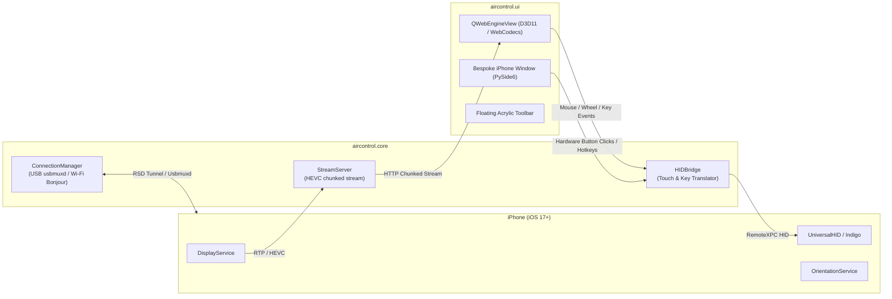

# Aircontrol: Architecture & Technical Design Specification

**Tác giả:** Antigravity Pairing Assistant  
**Ngày:** 22/09/2026  
**Trạng thái:** Approved by User  
**Dự án:** `Aircontrol` (`d:\Coding\Aircontrol`)

---

## 1. Bối Cảnh & Mục Tiêu Dự Án (Context & Objectives)

### 1.1. Bối cảnh
Dự án tiền nhiệm (`WinPhoneControl`) trước đây gặp các vấn đề lớn về kiến trúc:
- Sự phân mảnh và bùng nổ độ phức tạp qua nhiều lớp trừu tượng lồng nhau.
- Xung đột deadlock tầng C giữa bộ giải mã FFmpeg đa luồng và luồng sự kiện khi Apple DisplayService thay đổi tham số video (SPS/PPS) giữa phiên làm việc.
- Thiếu triết lý tận dụng mã nguồn mở sẵn có dẫn đến việc tự viết lại toàn bộ tầng RTP/RTCP và HID phức tạp.

### 1.2. Mục tiêu của Aircontrol
Xây dựng một phần mềm Windows hoàn toàn mới giúp:
1. **Truyền hình ảnh (Screen Mirroring)**: Hiển thị màn hình iPhone lên Windows với độ trễ thấp (<30ms), 60 FPS mượt mà bằng giải mã phần cứng GPU (WebCodecs Direct3D 11).
2. **Điều khiển từ xa (Remote Control)**: Cho phép thao tác chuột (chạm, rê kéo, vuốt cuộn trang), bàn phím và các phím cứng vật lý của iPhone (Home, Power, Vol+, Vol-, Mute).
3. **Giao diện độc bản (Bespoke iPhone UI)**: Khung máy mô phỏng chiếc iPhone 16 Pro cao cấp (viền titanium, Dynamic Island, các nút cứng tương tác trực tiếp trên thân máy) kèm thanh công cụ nổi Acrylic hiện đại.
4. **Kết nối linh hoạt**: Hỗ trợ kết nối cắm cáp USB độ trễ thấp và kết nối Wi-Fi qua mạng nội bộ LAN.
5. **Tận dụng tối đa thành phần chuẩn ngành**: Sử dụng lõi `pymobiledevice3` CoreDevice / RemoteXPC đã được cộng đồng xác minh tính ổn định, tránh phát minh lại bánh xe.

---

## 2. Kiến Trúc Hệ Thống (System Architecture)

Hệ thống được chia thành 3 tầng riêng biệt, đơn nhiệm:



### 2.1. Tầng Lõi Thiết Bị (`aircontrol.core`)
1. **`connection.py`**:
   - Quản lý danh sách thiết bị phát hiện qua USB (`usbmuxd`) và Wi-Fi (`Bonjour`).
   - Tự động thiết lập đường hầm `UserspaceRsdTunnel` (không yêu cầu quyền quản trị viên Admin trên Windows).
   - Tự động mount Developer Disk Image (DDI) khi cần thiết.
2. **`stream_server.py`**:
   - Sử dụng cơ chế phân giải gói tin RFC 7798 và phân phối luồng HEVC dạng HTTP Chunked Stream.
   - Nhờ chuyển việc giải mã sang WebCodecs của Chromium trên trình duyệt/WebView, hoàn toàn triệt tiêu nguy cơ treo/deadlock của các bộ giải mã FFmpeg CPU trên Windows.
3. **`hid_bridge.py`**:
   - Chuẩn hóa tọa độ chuột `[0..1]` thành tọa độ `[0..65535]` tương thích với màn hình cảm ứng điện dung của iOS.
   - Quản lý các cử chỉ vuốt, kéo (drag interpolation), cuộn trang mượt mà bằng con lăn chuột (mouse wheel).
   - Gửi các lệnh phím cứng (`Home`, `Lock/Power`, `Volume Up`, `Volume Down`, `Mute`) qua `IndigoHIDService`.

### 2.2. Tầng Giao Diện Người Dùng (`aircontrol.ui` & `aircontrol.web`)
1. **`window.py`**:
   - Cửa sổ Desktop Native chuẩn Bespoke Design: Thiết kế theo tỷ lệ chính xác của iPhone, viền bezel mỏng, bo góc squircle chuẩn Apple.
   - Các nút vật lý dọc theo 2 cạnh máy được vẽ bằng vector/CSS sắc nét, có phản hồi hover và hiệu ứng nhấn cơ học khi click.
   - Vùng đỉnh máy tích hợp Dynamic Island chân thực.
2. **`webcodecs_view.py`**:
   - Nhúng `QWebEngineView` được cấu hình kích hoạt đầy đủ GPU Acceleration (`--enable-gpu-rasterization`, `--enable-zero-copy`).
   - Tải giao diện WebCodecs siêu nhẹ nội bộ (`aircontrol/web/index.html`).
3. **`toolbar.py`**:
   - Thanh công cụ nổi Acrylic hiện đại với các biểu tượng đơn sắc: Chụp màn hình (`Ctrl+P`), Xoay máy (`Ctrl+R`), Bật/Tắt âm thanh, Bật/Tắt HUD thông số (`Ctrl+I`), Đổi chế độ viền khung máy.

---

## 3. Cấu Trúc Mã Nguồn (Repository Layout)

```
d:\Coding\Aircontrol\
├── aircontrol/
│   ├── __init__.py
│   ├── __main__.py              # Entrypoint khởi chạy: python -m aircontrol
│   ├── core/
│   │   ├── __init__.py
│   │   ├── connection.py        # Quản lý kết nối thiết bị iOS (USB & Wi-Fi)
│   │   ├── stream_server.py     # Cung cấp luồng dữ liệu HEVC cho WebCodecs
│   │   └── hid_bridge.py        # Bộ dịch tọa độ cảm ứng & phím cứng
│   ├── ui/
│   │   ├── __init__.py
│   │   ├── app.py               # Quản lý vòng đời ứng dụng PySide6 & Tray
│   │   ├── window.py            # Cửa sổ chính khung iPhone với nút bấm vật lý
│   │   ├── webcodecs_view.py    # Viewport QWebEngineView Direct3D 11
│   │   └── toolbar.py           # Thanh công cụ nổi Acrylic
│   └── web/
│       ├── index.html           # Viewport hiển thị màn hình & Dynamic Island
│       ├── app.js               # WebCodecs hardware decoder & input capture
│       └── style.css            # Thẩm mỹ Titanium iPhone, Be Vietnam Pro font
├── docs/
│   └── superpowers/
│       └── specs/
│           └── 2026-09-22-aircontrol-design.md
├── tests/
│   ├── test_connection.py
│   ├── test_hid_bridge.py
│   └── test_stream_server.py
├── pyproject.toml
└── run.bat
```

---

## 4. Kế Hoạch Xác Minh & Đảm Bảo Chất Lượng (Verification Plan)

### 4.1. Kiểm thử tự động (Unit & Integration Tests)
- Chạy `pytest tests -v` kiểm tra:
  - Khởi tạo kết nối và nhận diện thông tin thiết bị.
  - Bộ chuyển đổi tọa độ chuột và các gói tin báo cáo HID.
  - Vòng đời khởi tạo và đóng giải phóng cổng của Stream Server.

### 4.2. Kiểm thử thực tế (End-to-End Validation)
- Khởi chạy ứng dụng bằng `run.bat` hoặc `python -m aircontrol`.
- Kiểm tra giao diện hiển thị chuẩn khung máy iPhone, tỷ lệ màn hình chính xác.
- Thao tác chuột: Click mở ứng dụng, vuốt chuyển trang màn hình chính, dùng con lăn chuột cuộn lướt danh sách.
- Bấm các nút vật lý trên khung máy (Power, Volume, Home Bar) và kiểm tra phản hồi từ iPhone.
- Kiểm tra độ trễ (latency < 30ms) và mức tiêu thụ tài nguyên máy tính (CPU < 5%, GPU D3D11 Video Decoding hoạt động).
