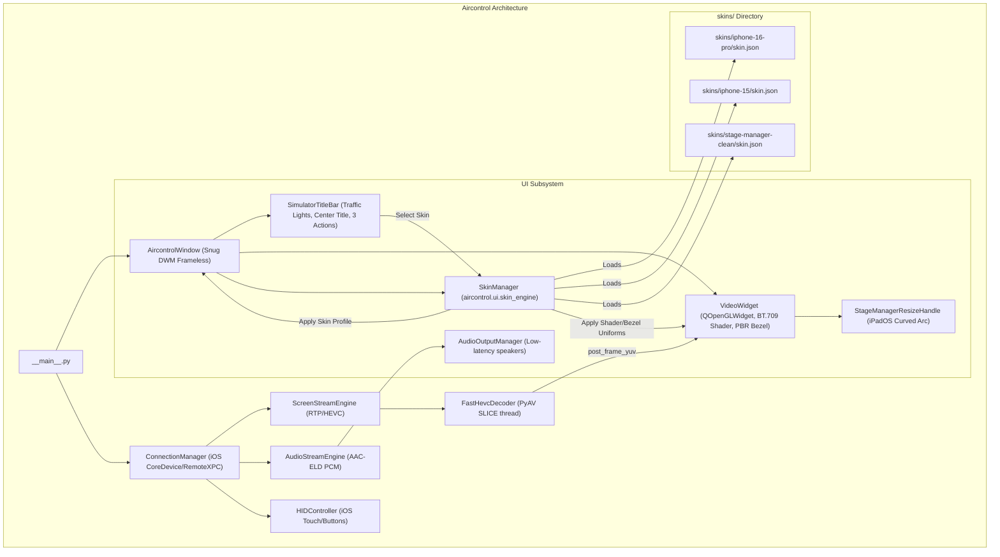

# Architectural Design: Extensible Device Skinning Engine & Streamlined UI for Aircontrol

**Date:** 2026-09-25  
**Status:** Approved  
**Target:** Python 3.13, PySide6 6.8+, OpenGL 3.3 Core Profile, Windows 11 DWM  

---

## 1. Executive Summary

Aircontrol mirrors iPhone screens onto Windows desktops at 60 FPS with low latency (<30ms). This architecture upgrade achieves two core objectives while maintaining a 100% native Python single-process architecture:
1. **Extensible Device Skinning & Framing Engine**: A modular, file-driven system (`skins/<skin_id>/`) supporting pluggable device profiles (iPhone 16 Pro Natural Titanium, iPhone 15, iPad Pro, Clean Minimalist Stage Manager). Supports procedural vector PBR metallic shaders and high-DPI texture bezels, with automatic device detection (`product_type`).
2. **Streamlined, Overflow-Free Titlebar**: Replaces the crowded 7-button cluster with an authentic 3-element control group (`[Audio]` `[Screenshot]` `[More •••]`), keeping the centered device title perfectly balanced and eliminating titlebar overflow on narrow iPhone portrait windows (~330px width).
3. **Guaranteed Visual Fidelity (Zero Aliasing & Zero Outer Borders)**:
   - Analytic Signed Distance Field (SDF) anti-aliasing via GPU shader (`fwidth` sub-pixel smoothing).
   - Concentric normalized coordinate system guaranteeing pixel-perfect alignment between screen and chassis at any scale.
   - Frameless translucent window wrapping snugly around the chassis with zero black void padding.

---

## 2. Architecture & Data Flow

---

## 3. Detailed Component Specifications

### 3.1 `aircontrol/ui/skin_engine.py` (New Module)

#### Dataclass `SkinProfile`:
- `id: str`: Unique identifier (e.g., `"iphone-16-pro-natural"`).
- `name: str`: Display name (e.g., `"iPhone 16 Pro (Natural Titanium)"`).
- `compatible_devices: list[str]`: List of Apple model IDs (e.g., `["iPhone16,1", "iPhone16,2", "iPhone17,1", "iPhone17,2"]`).
- `aspect_ratio: float`: Native screen aspect ratio (e.g., `9.0 / 19.5 = 0.461538`).
- `bezel_width_ratio: float`: Ratio of bezel thickness relative to display width (e.g., `0.024` for ultra-slim 1.5mm titanium border, `0.0` for borderless).
- `corner_radius_ratio: float`: Squircle curvature ratio (e.g., `0.09` for iPhone 16 Pro, `0.0` for rectangular).
- `has_dynamic_island: bool`: Whether to render the Dynamic Island pill cutout.
- `has_home_bar: bool`: Whether to render the bottom Home indicator bar.
- `chassis_color: tuple[float, float, float]`: Base RGB for metallic titanium finish (e.g., `(0.61, 0.64, 0.69)`).
- `chamfer_highlight: bool`: Whether to render CNC chamfer specular edge highlight.
- `texture_path: Optional[str]`: Path to optional high-DPI texture image if using bitmap bezel.

#### Class `SkinManager`:
- `load_skins(skins_dir: Path) -> dict[str, SkinProfile]`: Discovers and parses all `skin.json` manifests.
- `get_skin(skin_id: str) -> SkinProfile`: Returns skin by ID with fallback to default `"iphone-16-pro-natural"`.
- `match_device(product_type: str) -> SkinProfile`: Matches iOS device identifier to appropriate skin.
- `active_skin: SkinProfile`: Currently active skin profile.
- Signal `skin_changed(SkinProfile)`: Emits when user or auto-detection switches skins.

---

### 3.2 Bundled Skins (`skins/`)

1. **`skins/iphone-16-pro-natural/skin.json`** (Default):
   - Ultra-thin 1.5mm Natural Titanium brushed bezel with CNC chamfer reflection.
   - Dynamic Island pill and iOS Home Bar.
   - Aspect ratio `9.0 / 19.5`.
2. **`skins/iphone-16-pro-black/skin.json`**:
   - Black Titanium finish (`chassis_color: [0.18, 0.19, 0.21]`).
3. **`skins/iphone-15/skin.json`**:
   - Standard aluminum finish with softer corner curves.
4. **`skins/stage-manager-clean/skin.json`**:
   - `bezel_width_ratio: 0.0`: Zero bezel, 100% full-bleed display with Stage Manager curved resize handle.

---

### 3.3 Streamlined `SimulatorTitleBar` (`aircontrol/ui/simulator_titlebar.py`)

#### Layout & Dimensions:
- Fixed height: 32px.
- Left: 3 macOS Traffic Light buttons (`close`, `minimize`, `maximize/zoom`).
- Center: Centered Device Name (`iPhone 16 Pro`) and real-time telemetry (`60 FPS • 1179x2556`).
- Right (Total width ~72px):
  1. `btn_audio` (`ActionIconButton("speaker")`): Toggles iPhone audio playback through PC speakers.
  2. `btn_camera` (`ActionIconButton("camera")`): 1-Click high-resolution PNG screenshot (`Ctrl+P`).
  3. `btn_more` (`ActionIconButton("more")` with 3 horizontal dots icon `•••`): Opens modern QMenu.

#### Dropdown Menu (`btn_more`):
- **Đổi Vỏ Máy (Device Skins)**: Submenu listing all discovered skins with checkmarks.
- **Khung Viền / Không Viền (`Ctrl+B`)**: Toggles between chassis mode and borderless Stage Manager mode.
- **Xoay Màn Hình (`Ctrl+R`)**: Triggers 90-degree clockwise orientation change.
- **Bàn Phím Ảo (`Ctrl+K`)**: Opens text input bridge.
- **Giảm Sáng Màn Hình iPhone (`Ctrl+Shift+D`)**: Dims physical iPhone screen to save battery and reduce heat.
- **Thông Số Kỹ Thuật (HUD Info)**: Displays network delay, codec, and dropped packet stats.

---

### 3.4 Pixel-Perfect OpenGL Viewport & Zero-Border Window Integration

#### `aircontrol/ui/video_widget.py`:
- In `paintGL()`:
  - Query `active_skin` parameters.
  - Calculate `u_screen_size` and `u_bezel_width` from `active_skin.bezel_width_ratio`.
  - In fragment shader:
    - Compute `d_chassis` and `d_screen` using concentric coordinates.
    - Set `FragColor.a = chassis_alpha` using `smoothstep(fwidth(d_chassis), -fwidth(d_chassis), d_chassis)`.
    - Pixels outside the squircle chassis are 100% transparent (`alpha = 0.0`), eliminating any rectangular black background void.
- In mouse event handling (`mousePressEvent`, `mouseMoveEvent`, `mouseReleaseEvent`):
  - Check if click falls within physical button hot zones on the bezel (e.g., Power button, Volume buttons).
  - If inside `screen_rect`: Normalize coordinates precisely to iOS `[0..65535]` space:
    $$\text{norm\_x} = \text{clamp}\left(\frac{x - \text{screen\_x}}{\text{screen\_w}} \times 65535, 0, 65535\right)$$
    $$\text{norm\_y} = \text{clamp}\left(\frac{y - \text{screen\_y}}{\text{screen\_h}} \times 65535, 0, 65535\right)$$

#### `aircontrol/ui/window.py`:
- `_calc_window_width(height)`:
  - Adapts to active skin aspect ratio and bezel thickness:
    $$\text{content\_h} = \text{height} - \text{titlebar\_height}$$
    $$\text{vw} = \text{content\_h} \times \text{skin.aspect\_ratio}$$
    $$\text{width} = \text{round}(\text{vw} + 2 \times \text{bezel\_pixels})$$
- `_calc_window_height(width)`: Symmetrical calculation ensuring strict aspect lock without black borders.

---

## 4. Verification & Testing Plan

1. **Unit Tests (`tests/test_skin_engine.py`)**:
   - Test scanning and loading of bundled skins (`iphone-16-pro-natural`, `iphone-16-pro-black`, `stage-manager-clean`).
   - Test manifest JSON schema validation and default fallbacks on corrupted JSON.
   - Test automatic device identifier matching (`iPhone16,1` -> `iphone-16-pro-natural`).
   - Test aspect ratio and relative inset calculations.
2. **Titlebar Tests (`tests/test_simulator_titlebar.py`)**:
   - Verify 3-button layout (`btn_audio`, `btn_camera`, `btn_more`).
   - Verify `btn_more` dropdown menu actions and signal propagation.
   - Verify titlebar width remains <= 280px on 320px window, preventing title overlap.
3. **Window & Rendering Tests (`tests/test_ui_window.py`)**:
   - Test dynamic skin switching at runtime while keeping stream active.
   - Test snug window resize calculations across all skin profiles.
   - Verify 100% test pass rate on all tests (`pytest tests -v`).
